# Daybook change log

A running record of every change requested, newest first, with screenshots. It lives in the project folder only; nothing here appears in the app.

**How it works**
- Each request gets an entry: date, what you asked for, what changed, and screenshots taken *after* the change.
- Screenshots are saved to `screenshots/<date>-<slug>/`. Claude takes them with `npm run shots -- <slug>` (needs the dev server running). Add `--dark` for a dark-theme set.
- Entries are written as plain sentences. Files touched are listed so a change can be traced or reverted.

---

## 2026-11-19 — Timeline day and week views, blue today in the month view

**Asked for:** the day view in the style of the reference image (a timeline with a rail, big times and outlined cards), with every hour still shown. Kept on its own branch so it can be dropped. Follow-ups: no "Done" label or check mark, the UI font for the times, equal hour spacing, no Open button, a blue Now tag with the time under it, before the rail.

**What changed (Calendar → Day and Week; month and schedule are untouched)**
- A rail with a label for every hour (`07:00`, `PM` underneath) in the normal UI font and weight, with a small square marker and a thin line across the day at every hour. Labels and markers look the same whether or not an hour has events. Every hour is exactly the same height.
- Events are cards in the same solid calendar colour with white text as in the week view, placed at their real time inside the hour and sized by duration. Short events show one line (title and time); longer ones show the title, the description when there is room, and tags for time range, duration, calendar and location. Overlapping events sit side by side.
- Completed events keep the struck-through title, with no label. Cards have no small square, and the current hour is not highlighted.
- **Week view uses the same design language:** the hour column has the same `07:00` / `PM` labels, a rail with square markers and the blue "Now" tag with the time under it; the "Now" line is the primary blue; event cards have the same square corners. Dragging to create and move events still works in the week view. On a phone the hour labels shrink to fit.
- Week and day event cards are now one shared component, so they always match. What a card shows depends on its height: one line (title and start time) for short events, title plus time range for medium ones, and title plus tags for time range, duration and calendar for tall ones. Recurring events show the repeat icon in both views.
- The month view marks today with a blue circle around the date, like the "19" at the top of the week view, instead of the olive pill.
- A small "Now" label next to the line inside today's column was tried and removed. The blue "Now" tag with the time stays on the hour column.
- Known trade-off: in the week view the "Now" tag sits on the narrow hour column, so it can overlap the nearest hour label for a few minutes either side of the hour.
- A blue "Now" tag (the primary colour) with the time stacked under it sits to the left of the rail, with a short line to a dot on the rail.
- Clicking an empty spot opens a new event at that time (30-minute steps). All-day events sit in an "All day" row at the top.
- Not in this version: dragging to create or move events in the day view (the week view still has it).

**Files:** `components/calendar/DayTimeline.tsx` (new), `components/calendar/EventCard.tsx` (new), `components/calendar/eventStyle.ts` (new), `components/calendar/CalendarScreen.tsx`, `components/calendar/TimeGrid.tsx`, `components/calendar/MonthView.tsx`

**Screenshots** (`screenshots/2026-11-19-day-timeline/`)
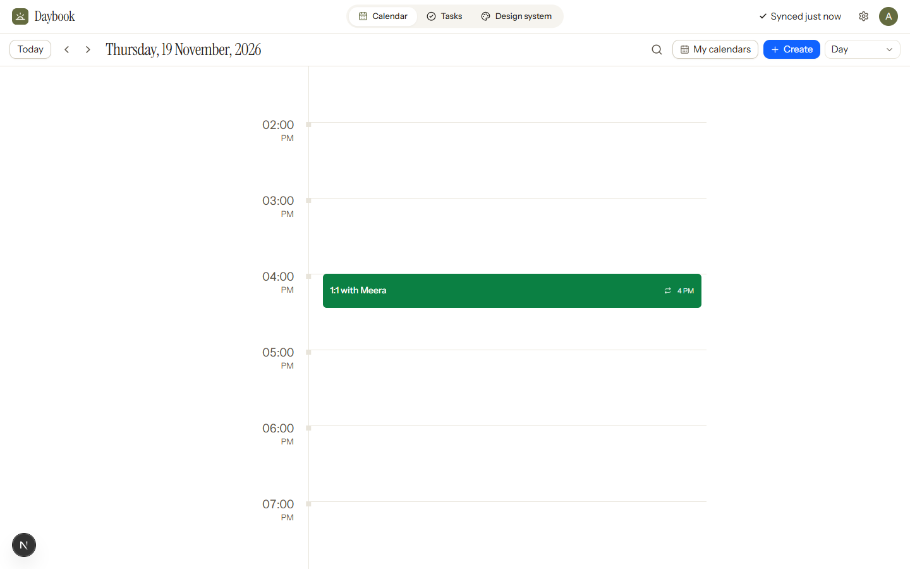
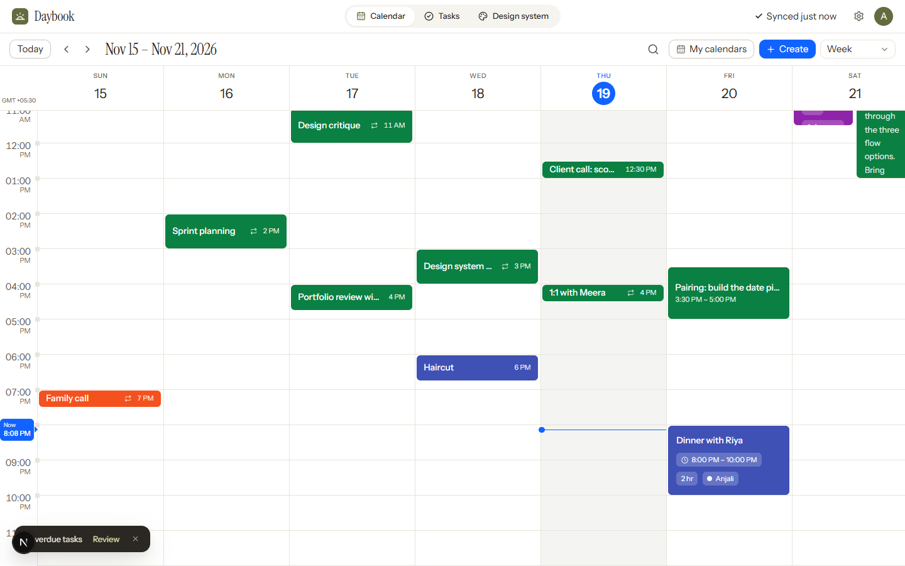
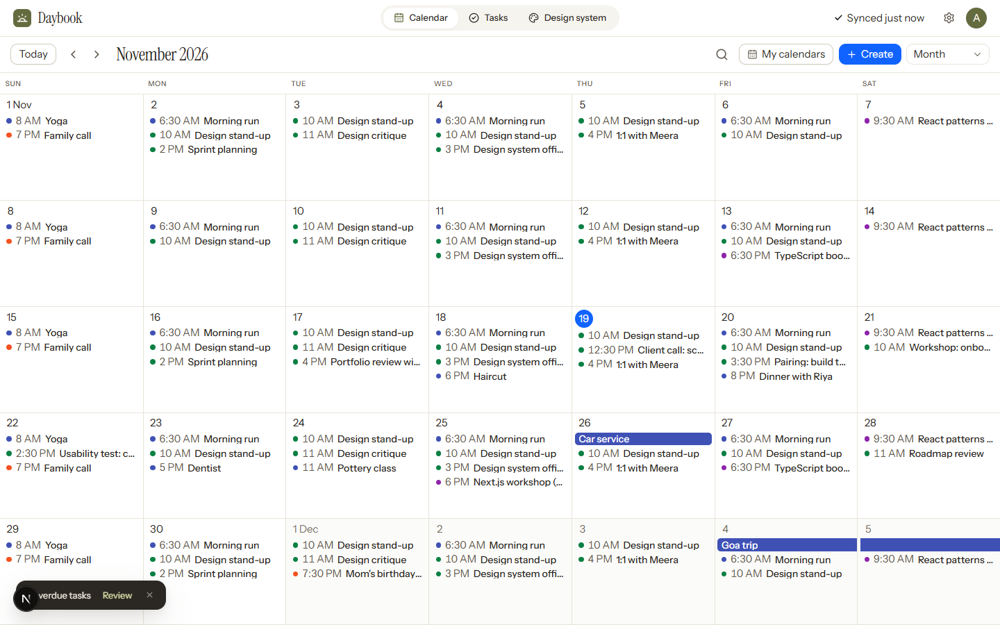

---

## 2026-11-19 — One header, no sidebar, solid event cards, tidier day views

**Asked for:** put My calendars in the header and remove the left sidebar; event cards in the plain calendar colour, not light tints; search and Create in the same header; the Tasks tab with the same single header; Tasks day view stacked one under the other; a maximum width for the day view on both tabs; no Completed section and no "Thu 19" block in the day view.

**What changed**
- The left sidebar (side sheet with Create, mini month and calendar list) is removed. **My calendars** is now a button in the header with a dropdown: show or hide each calendar, "All", "Display only this", and colour.
- Calendar header is one row: Today, previous and next, the date, Search, My calendars, Create, and the view switch. Search and Create no longer sit in a second row.
- Tasks has the same single header: Search, Filter, Add task and the view switch. Phones keep a small search and filter row below, because the header has no room for them.
- Event cards use the solid calendar colour with white text (week and day grid, all-day row, month banners). Completed events stay struck through.
- Day view on both tabs is one centred column with a maximum width (about 48rem), not stretched. In Tasks the cards stack one under the other.
- Day view hides the Completed section and the big day header (the page heading already names the day). Week view still shows both.

**Files:** `components/calendar/MyCalendars.tsx` (new), `components/calendar/Toolbar.tsx`, `components/calendar/CalendarScreen.tsx`, `components/calendar/TimeGrid.tsx`, `components/calendar/MonthView.tsx`, `components/shell/DateHeader.tsx`, `components/tasks/TasksScreen.tsx`, `components/home/Hero.tsx`, `lib/store/ui.ts`; `components/calendar/Sidebar.tsx` deleted

**Screenshots** (`screenshots/2026-11-19-one-header-and-day-views/`)
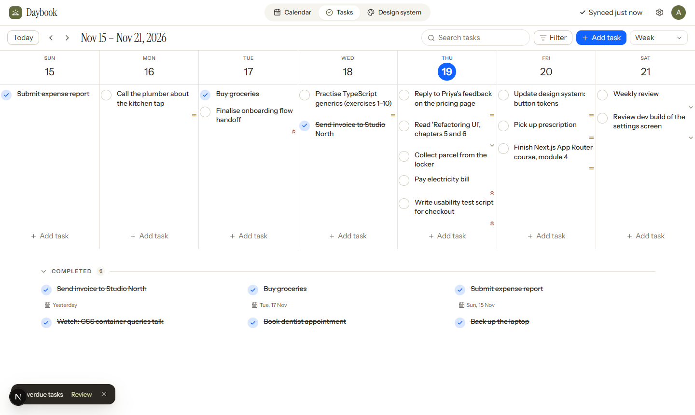
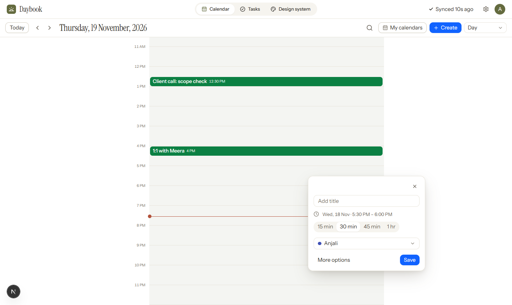
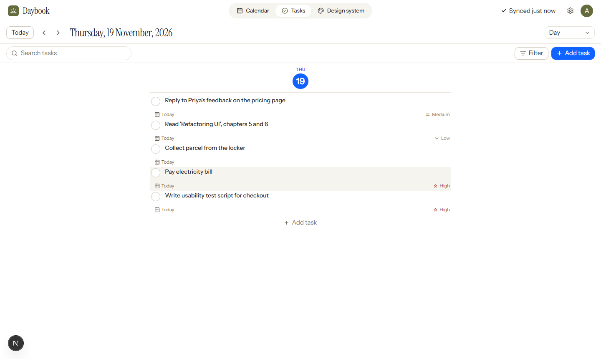

---

## 2026-11-19 — Completed at the end, shared title style, week range, tidy-ups

**Asked for:** remove the grid/list switch beside Add task; a COMPLETED section at the end of the Tasks page; event titles in the same style as task titles; the week view heading as a date range; remove the "Visibility and colours here apply to this app only" note.

**What changed**
- The grid/list layout switch beside **Add task** is removed. The toolbar now has Filter and Add task only.
- The **Completed** section at the end of the Tasks page lists every completed task, newest first, and is open by default. Completed tasks also stay struck through in their day column.
- In Week view the heading reads "Nov 15 – Nov 21, 2026" instead of "November 2026", on Calendar and Tasks (desktop). Across a year it reads "Dec 28, 2026 – Jan 3, 2027". Phones keep the short month and year.
- The note under the calendar list ("Visibility and colours here apply to this app only…") is removed.
- Event titles use exactly the task title style (14px, medium weight, same line height) in the week and day grid, the all-day row, the month view, the schedule list and the drag preview. Measured in the browser: task and event titles read the same size and weight.

**Files:** `lib/weekTitle.ts`, `components/calendar/Toolbar.tsx`, `components/calendar/Sidebar.tsx`, `components/tasks/TasksScreen.tsx`, `components/tasks/TaskControls.tsx`, `lib/store/ui.ts`, `components/calendar/TimeGrid.tsx`, `components/calendar/MonthView.tsx`, `components/calendar/ScheduleView.tsx`

**Screenshots** (`screenshots/2026-11-19-completed-and-titles/`)
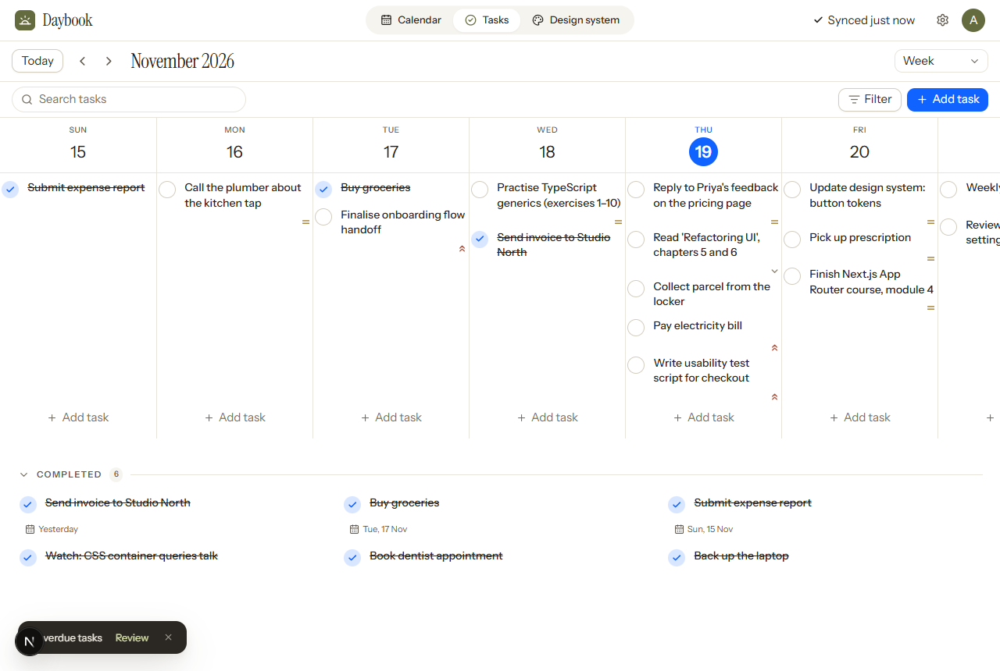
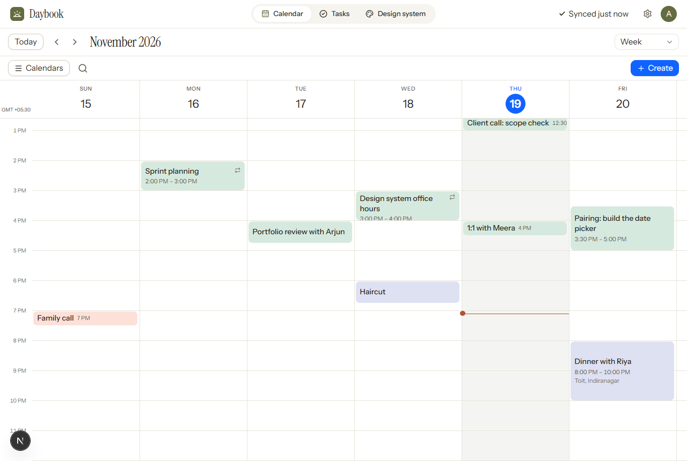
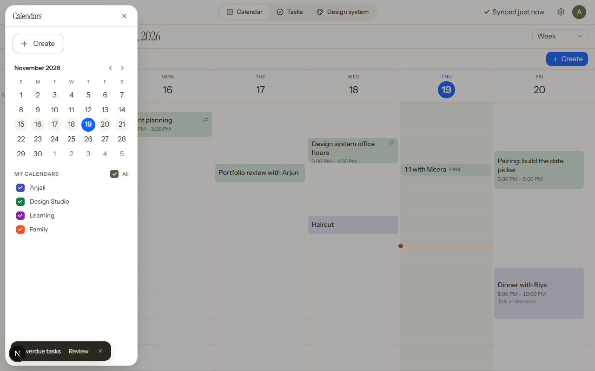
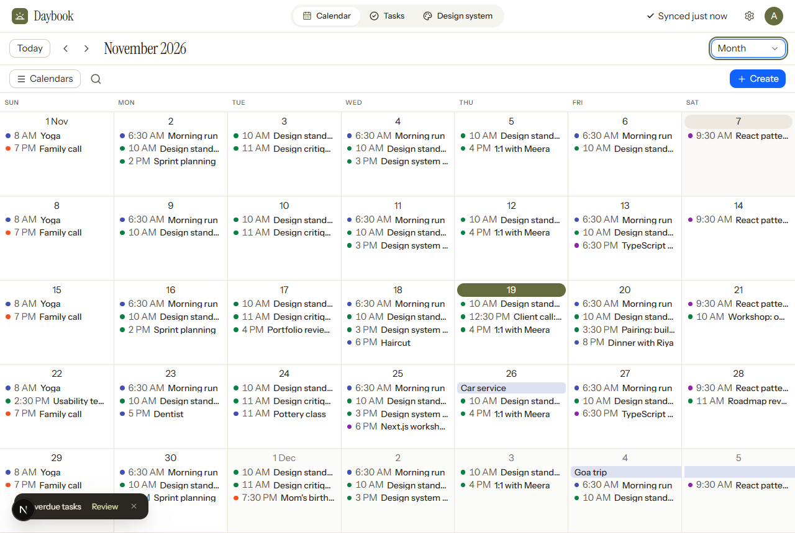

---

## 2026-11-19 — Design system tab hidden in production

**Asked for:** show the Design system tab only locally, not in production.

**What changed**
- The Design system tab is in the header and phone bar only when running `npm run dev`. The deployed site shows Calendar and Tasks only.
- Opening `/design-system` in production shows the "page could not be found" screen.
- Checked with a production build: no Design system link on desktop or phone.

**Files:** `components/shell/Header.tsx`, `app/(app)/design-system/page.tsx`

---

## 2026-11-19 — Log out in the account menu

**Asked for:** a log out option (it was only inside Settings).

**What changed**
- The round avatar at the top right now opens a menu with the signed-in email and a **Log out** item. The avatar shows the first letter of the email.
- Log out ends the session and returns to the home page. The same button in Settings → Account & sync now reads "Log out".
- Only shown when Supabase sign-in is on.

**Not checked in a browser:** needs a signed-in session, so no screenshot yet.

**Files:** `components/shell/Header.tsx`, `components/settings/SettingsDialog.tsx`, `lib/supabase/signOut.ts`

---

## 2026-11-19 — Better home page

**Asked for:** improve the home page design, keep one hero section only.

**What changed**
- Still one hero. Headline "Plan the day. Finish the work.", a short line, **Log in** and **Create an account** buttons, and three one-line benefits.
- A small picture of the real app sits beside it: a week of coloured events with today highlighted, and three task cards, one completed and struck through. On phones it sits below the text and shows three days.
- **Create an account** opens the popup on the Sign up tab; **Log in** opens it on Log in. A small Log in button is also in the top corner.
- Colours come from the existing tokens and calendar palette. Without Supabase keys the buttons read "Open Daybook" and go straight to the app.

**Files:** `components/home/Hero.tsx`

**Screenshots** (`screenshots/2026-11-19-home-page/`)
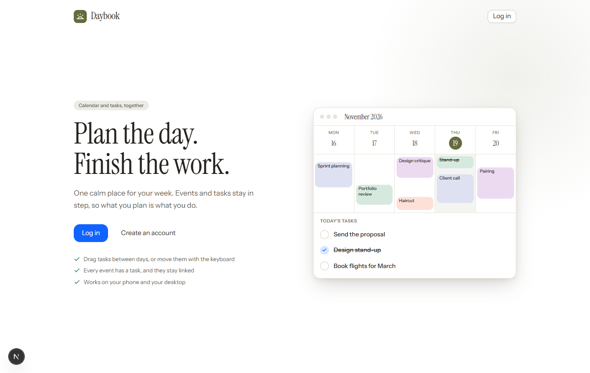
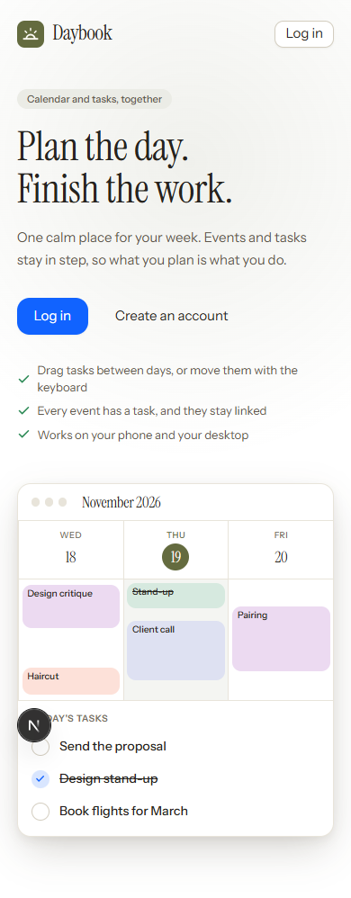
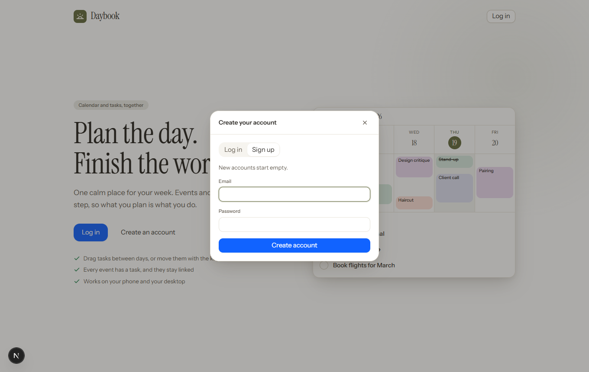

---

## 2026-11-19 — Login, card moves, and clean-up

**Asked for:** a login; a simple home page with only a hero and a Log in button that opens a log in / sign up popup, then opens the app; keyboard and touch ways to move task cards; strikethrough on calendar events whose task is complete; no overdue marks in the Tasks tab; fix the duplicate "Design stand-up" tasks.

**What changed**
- Home page is one hero with a Log in button. The popup has Log in and Sign up; signing in opens the Calendar. New accounts start empty.
- Sign-in uses Supabase. Tasks and events save to the signed-in account (`supabase/schema.sql`, row-level security). Without Supabase keys the app still runs on local sample data with no login. Settings → Account has Sign out.
- Alt+Left / Alt+Right moves a focused task card one day and keeps focus. On touch screens, press and hold a card, then drag it to another day.
- Calendar event titles are struck through when the linked task is completed (week, all-day row, month, schedule).
- Overdue marks removed from task cards, day counts and month dots. The Overdue filter and section remain.
- Duplicate tasks fixed: a load or sync that overlapped a write could drop and re-create tasks. Snapshots are now refetched if a write overlapped them.
- Also in this batch: light only (dark mode removed), colours from tokens only, repeating tasks create their occurrences a month ahead, tasks need a date, time is optional with no default, the "All day" toggle and "Everything else" section removed.

**Not done yet:** Supabase sign-in has not been tried against a real project. Google Calendar and Tasks sync is still to come.

**Files:** `app/page.tsx`, `components/home/*`, `proxy.ts`, `lib/supabase/*`, `lib/data/supabase/supabaseRepository.ts`, `lib/store/data.ts`, `components/tasks/TasksScreen.tsx`, `components/tasks/TaskCard.tsx`, `components/calendar/*`, `components/settings/SettingsDialog.tsx`, `supabase/schema.sql`

**Screenshots** (`screenshots/2026-11-19-login-and-card-moves/`)
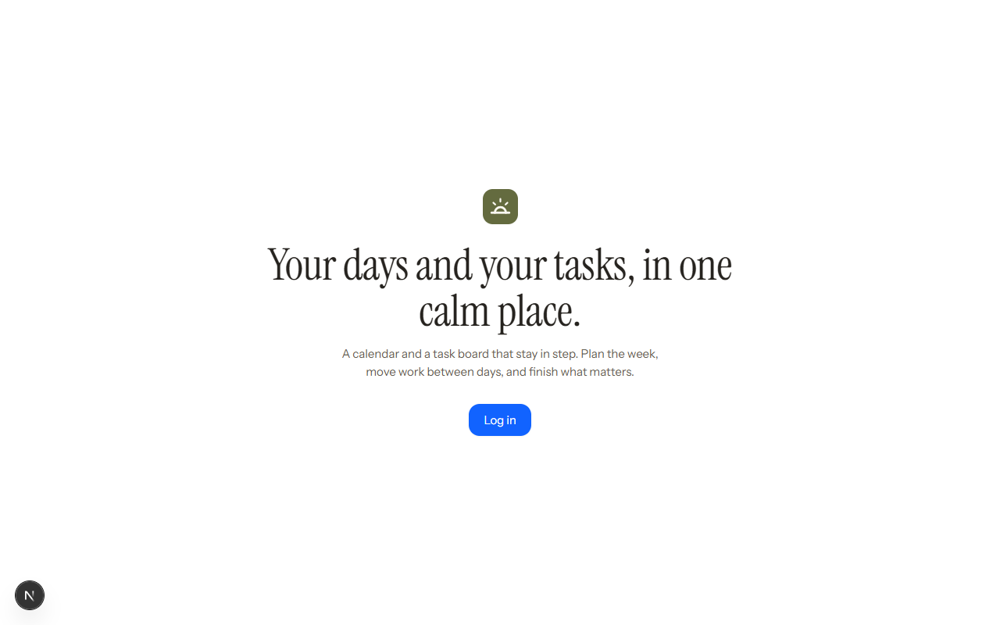
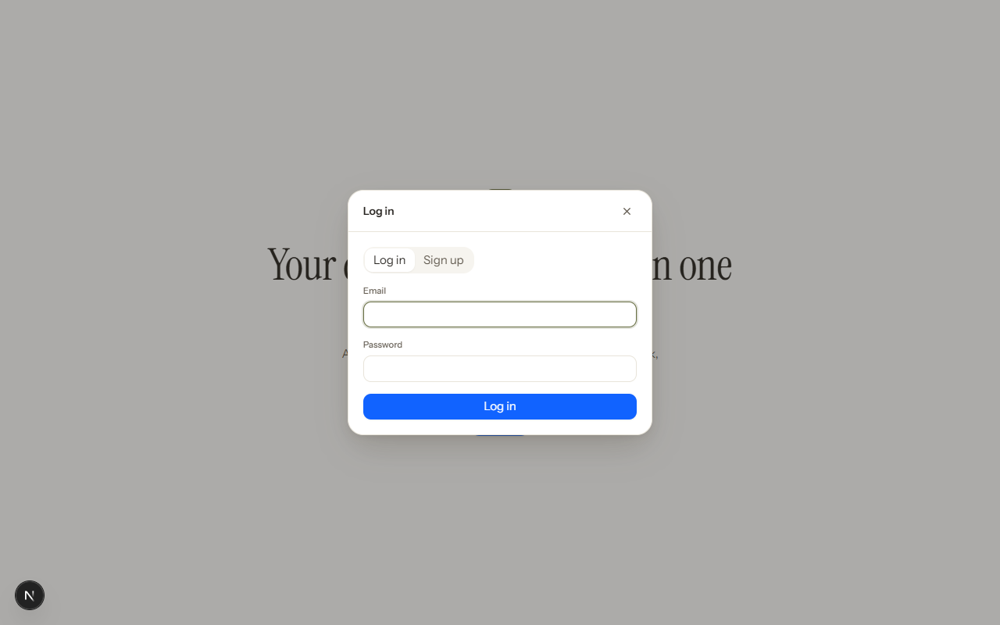
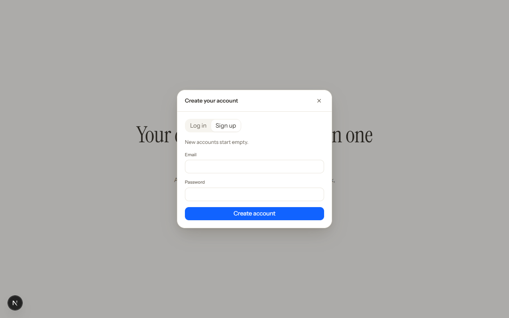
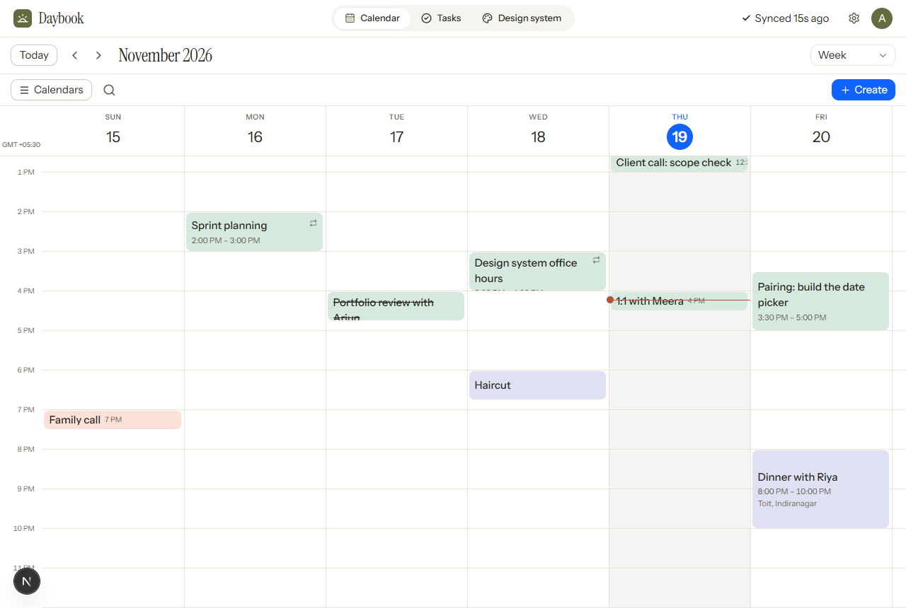
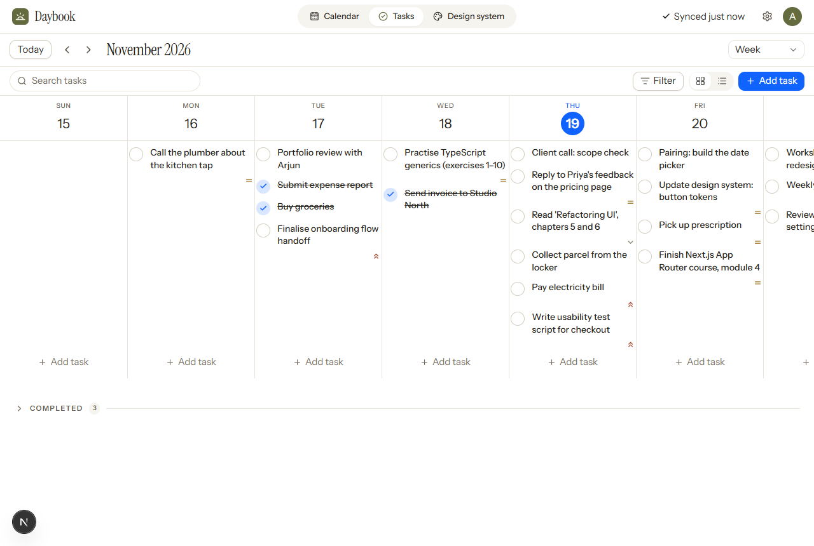

---

## 2026-11-19 — Every calendar event has a task

**Asked for:** every event should have a task (for example "Design stand-up" appears in the Tasks view); linked both ways; recurring events get one repeating task; all-day events get a task with no time; deleting the event deletes its task after confirmation; completing the task keeps the event.

**What changed**
- Each event gets a linked task, on load and when an event is created. Existing sample events get tasks too.
- Changing an event's date, time, title, calendar or repeat updates its task, and the reverse.
- All day on a task makes its event all day. Clearing the time no longer deletes the event; it becomes all day.
- Deleting an event asks for confirmation, then deletes its task. Deleting a task deletes its event.
- Repeat on a task is saved to its event's recurrence.

**Not done yet:** completing a repeating task only marks it complete; it doesn't move to the next date.

**Files:** `lib/store/data.ts`, `lib/store/eventActions.ts`, `components/calendar/EventLayers.tsx`, `components/tasks/TaskLayers.tsx`, `components/ui/RepeatSelect.tsx`, `scripts/event-tasks.mjs`

**Screenshots** (`screenshots/2026-11-19-event-tasks/`)
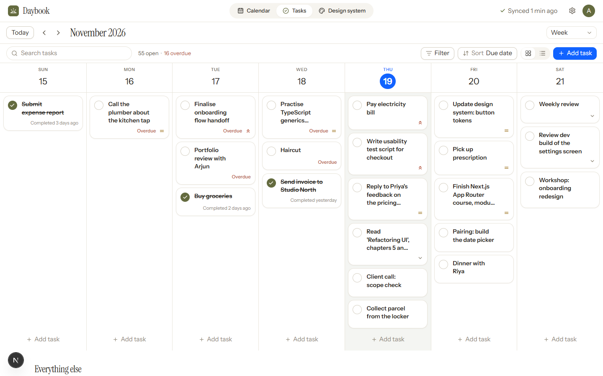

---

## 2026-11-19 — Event editor opens as a side sheet

**Asked for:** the event should open as a side sheet, like the task details.

**What changed**
- The event editor opens in the same side sheet as task details, with a header bar and close button. It was a centred dialog before.

**Files:** `components/calendar/EventLayers.tsx`

---

## 2026-11-19 — Tasks always have a time, like the calendar

**Asked for:** match the calendar exactly: no Add time button; Date and Time as separate fields, with the time below the date; All day to switch the time off.

**What changed**
- Date and Time are separate fields in both the event editor and the task sheet. The time row sits below the date.
- Tasks have a time like events. New tasks start at 9:00 AM. Add time is removed.
- The All day switch sits below the time. On a task it removes the time and its calendar event; the task keeps its date.
- Every task with a date now creates a calendar event. This is what you asked for, but it means the calendar will fill up with task events.

**Files:** `components/ui/DateTimeRow.tsx`, `components/tasks/TaskLayers.tsx`, `components/calendar/EventLayers.tsx`, `scripts/task-time-link.mjs`

---

## 2026-11-19 — Event and task use one date and time row

**Asked for:** the event's time should match the task's time design.

**What changed**
- The event editor and the task sheet share one date and time row (`components/ui/DateTimeRow.tsx`): date, start time, "to", end time, duration.
- Tasks can have no time, so they get "Add time" and a remove button. Events always have a time, so the event row has neither.
- The All day switch stays below the row in the event editor.

**Files:** `components/ui/DateTimeRow.tsx`, `components/tasks/TaskLayers.tsx`, `components/calendar/EventLayers.tsx`

**Screenshots** (`screenshots/2026-11-19-event-datetime/`)
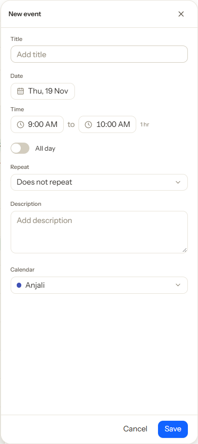

---

## 2026-11-19 — Event date reads like the calendar

**Asked for:** the event's date and time should look like the calendar's date and time.

**What changed**
- The event editor's date shows the plain calendar format, for example "Thu, 19 Nov", not "Today · Thu, 19 Nov".
- "Today" and "Tomorrow" before the date still appear in the task sheet and New task form, where you asked for them.

**Files:** `components/ui/DatePicker.tsx`, `components/tasks/TaskLayers.tsx`, `scripts/event-editor.mjs`

**Screenshots** (`screenshots/2026-11-19-event-datetime/`)

---

## 2026-11-19 — Tasks with a time, linked to the calendar

**Asked for:** an optional time on tasks (in the New task form and the task sheet), laid out like the calendar; a timed task becomes a calendar event; the two stay connected; deleting a task asks first; clearing the time removes only the event.

**What changed**
- Date and time is one row, as in the calendar: date, start time, "to", end time, duration. "Add time" appears once a date is set.
- A task with a time creates a calendar event on its calendar, with the same title, start and end. Changing the task's date, time, title or calendar moves or updates the event.
- Changing the event's date, time or title updates the task.
- Clearing the time deletes the event and keeps the task.
- Completing a task leaves its event alone.
- Deleting a task asks first, and says that its event will also be deleted.
- "Rename" in the label: "Due date" is now "Date".

**Files:** `lib/types.ts`, `lib/store/data.ts`, `lib/store/ui.ts`, `lib/data/mock/mockRepository.ts`, `components/tasks/TaskLayers.tsx`, `components/tasks/TaskCard.tsx`, `scripts/task-time-link.mjs`

**Screenshots** (`screenshots/2026-11-19-task-time/`)
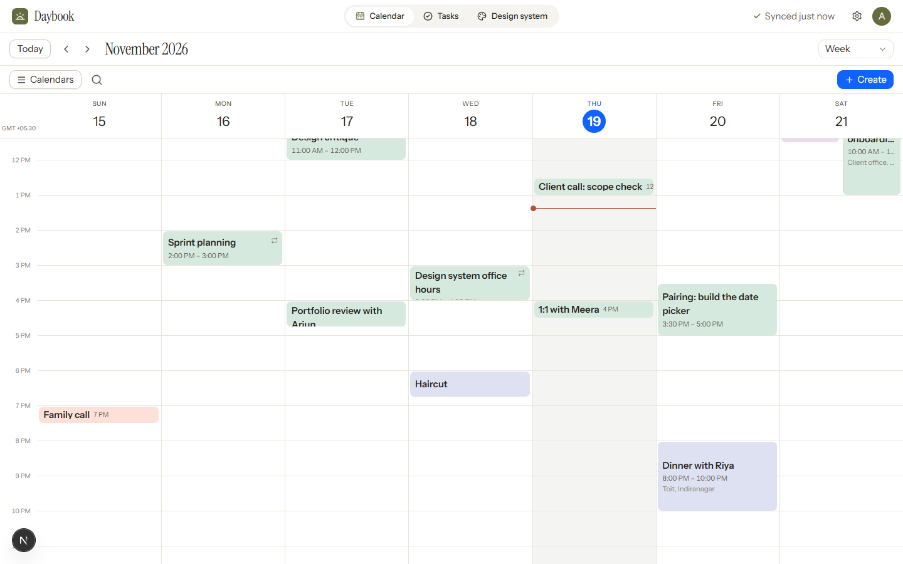

---

## 2026-11-19 — Day columns: priority first, newest first

**Asked for:** in each day's column, higher priority always at the top; within the same priority, the newest task at the top.

**What changed**
- Day columns sort by priority (high, medium, low, none), then by creation time with the newest first.
- The column order is set in `columnOrder` (`components/tasks/taskModel.ts`). The list view below the columns keeps its own sort setting.

**Files:** `components/tasks/taskModel.ts`, `components/tasks/TasksScreen.tsx`

**Screenshots** (`screenshots/2026-11-19-day-column-order/`)
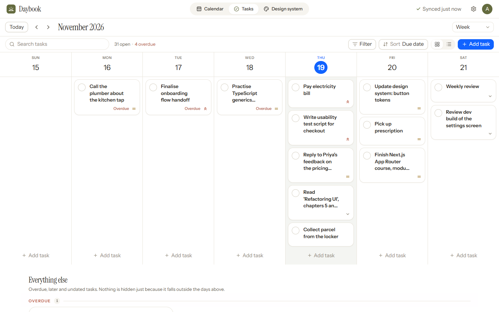

---

## 2026-11-19 — New task: "Already completed" checkbox below Subtasks

**Asked for:** keep Mark complete in New task, but with less visual weight than Add subtask.

**What changed**
- Mark complete is now a circle checkbox labelled "Already completed", below the Subtasks section. Ticking it shows "Completed".
- The footer is back to Cancel and Save only.

**Files:** `components/tasks/TaskLayers.tsx`, `scripts/new-task-complete.mjs`

**Screenshots** (`screenshots/2026-11-19-already-completed/`)
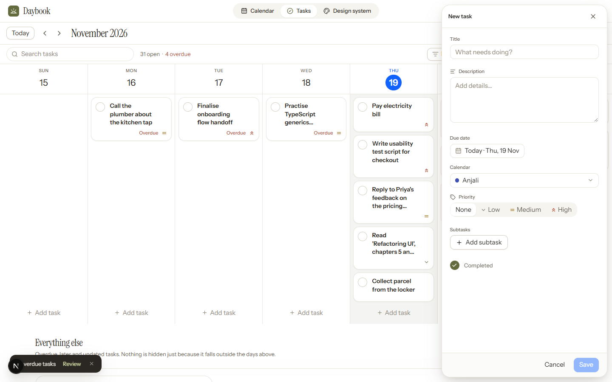

---

## 2026-11-19 — New task: Mark complete moved to the footer

**Asked for:** option 1 — Mark complete in the footer, separate from the subtasks.

**What changed**
- In the New task form, Mark complete is in the footer on the left, as a secondary button. Cancel and Save are on the right.
- It no longer sits in the scrollable body next to Add subtask.

**Files:** `components/tasks/TaskLayers.tsx`, `scripts/new-task-footer.mjs`

**Screenshots** (`screenshots/2026-11-19-new-task-footer/`)
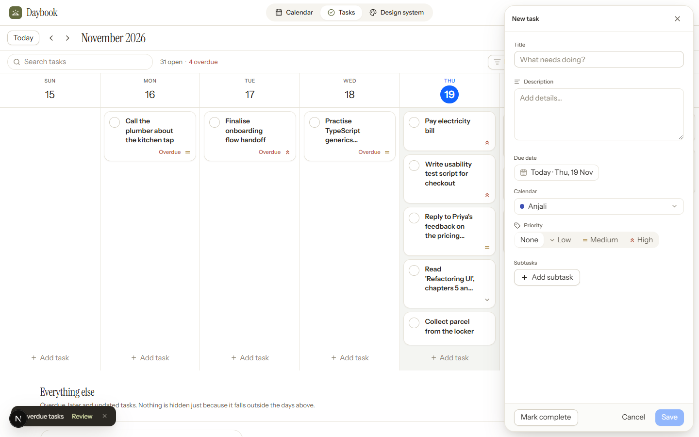

---

## 2026-11-19 — Scroll to the new subtask input

**Asked for:** when adding subtasks one below another, the view should scroll so the new input stays visible.

**What changed**
- After each subtask is added with Enter, the input scrolls into view (the browser term is "scroll into view").
- Applies in the task sheet and the New task form.

**Files:** `components/tasks/TaskLayers.tsx`, `scripts/subtask-scroll.mjs`

**Screenshots** (`screenshots/2026-11-19-subtask-scroll/`)
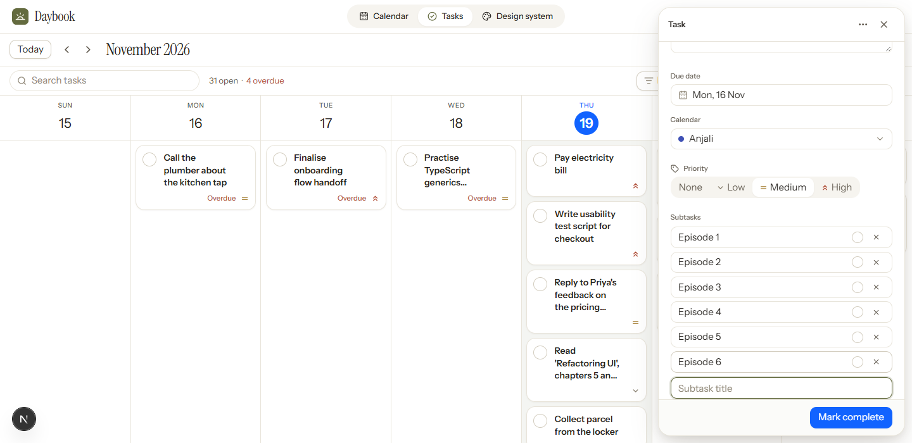

---

## 2026-11-19 — Subtasks work like Google Tasks

**Asked for:** Add subtask button unchanged; each subtask looks like an input field with a checkbox and × on the right; click a subtask to edit it; the new subtask input appears below the list; remove the subtask count.

**What changed**
- Each subtask is a rounded input-style row: title on the left, checkbox and × on the right.
- Click a subtask's title to edit it. Enter or clicking away saves, Escape cancels.
- The new subtask input sits below the existing subtasks. Enter saves and opens a new input.
- The count next to "Subtasks" is removed.
- The New task form uses the same rows. Pending subtasks keep their checkbox state when the task is saved.

**Files:** `components/tasks/TaskLayers.tsx`, `scripts/subtask-sheet.mjs`

**Screenshots** (`screenshots/2026-11-19-subtask-rows/`)
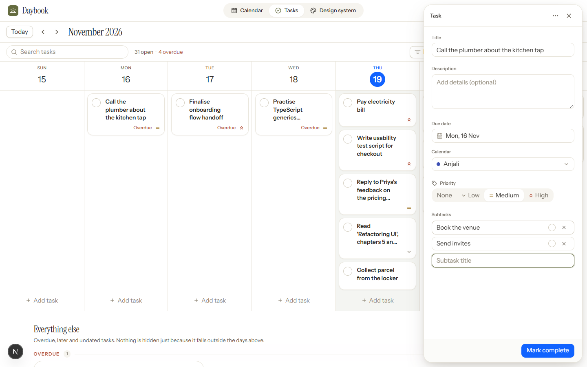

---

## 2026-11-19 — Subtasks, task sheet layout, card label removed

**Asked for:** subtasks inside a task; the task sheet to match New task (Due date and Calendar stacked, Delete in the top menu); remove the list label from task cards.

**What changed**
- A **Subtasks** section in the task sheet, below Priority. Type a title and press Enter (or Add) to create one; tick it to complete it; × deletes it. The count shows done/total.
- A subtask is a task that points at its parent and uses the same list and calendar. Subtasks don't appear as separate cards on the Tasks view.
- Due date and Calendar are stacked in the task sheet, as in New task.
- The list label is removed from task cards.
- Delete task is back in the ••• menu at the top of the task sheet.

**Files:** `lib/types.ts`, `lib/store/data.ts`, `lib/data/mock/mockRepository.ts`, `components/tasks/TasksScreen.tsx`, `components/tasks/TaskLayers.tsx`, `components/tasks/TaskCard.tsx`

**Screenshots** (`screenshots/2026-11-19-subtasks/`)
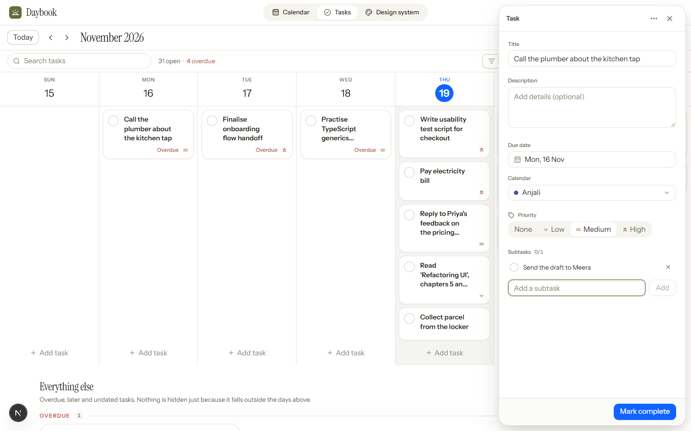

---

## 2026-11-19 — Side sheets: New task and task details

**Asked for:** keep screenshots of the current New task side sheet and of the side sheet that opens when a task is clicked.

**What changed**
- New task opens in the same side sheet as task details, with Cancel and Save at the bottom right.
- The Due date field shows "Today · Thu, 19 Nov" (and the same format for Tomorrow).
- "Location" is removed from the new event form, and the "In 2 weeks" quick pick is removed from the date popup.

**Files:** `components/ui/Modal.tsx`, `components/tasks/TaskLayers.tsx`, `components/ui/DatePicker.tsx`, `components/calendar/EventLayers.tsx`, `scripts/sheets.mjs`

**Screenshots** (`screenshots/2026-11-19-side-sheets/`)
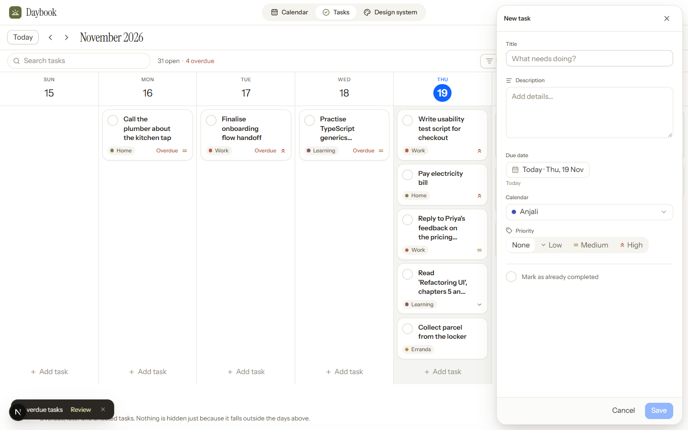
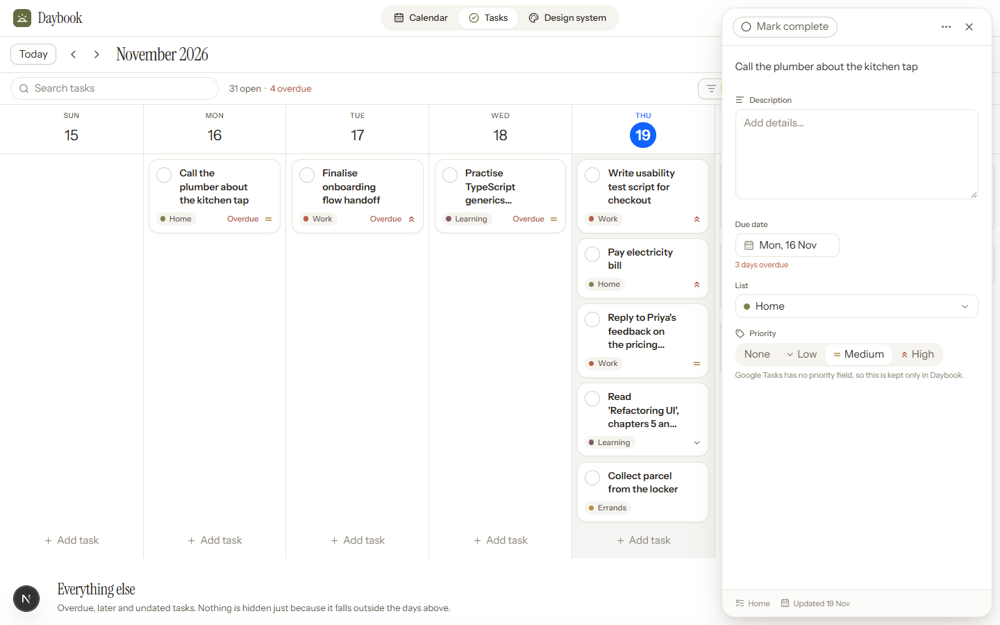

---

## 2026-11-19 — New task form matches the side sheet; no scroll behind dialogs

**Asked for:** the new task form to match the task side sheet; remove "Show in Calendar"; remove "This app only" next to priority in both places; scrolling should only move the dialog, not the page behind it.

**What changed**
- The new task form uses the same layout as the side sheet: large title field, Description field below it, then Due date, Calendar and Priority with the same icons.
- "Show in Calendar" is removed.
- "This app only" is removed from the Priority label in the new task form and in the side sheet.
- Scrolling over the dimmed background no longer moves the page behind a dialog or sheet. The form's body is the only scrolling area inside it.

**Files:** `components/tasks/TaskLayers.tsx`, `components/ui/Modal.tsx`

**Screenshots** (`screenshots/2026-11-19-task-form-scroll/`)

---

## 2026-11-19 — Add task: title label, calendar picker, mark as completed

**Asked for:** a Title label; remove the List field; replace it with a choice of calendar (Family, Anjali, etc.); an option at the bottom to mark the task as already done.

**What changed**
- A **Title** label sits above the title field.
- The List field is removed. Tasks still go to the default Google Tasks list in the background.
- A **Calendar** field lists your calendars and defaults to your primary calendar (Anjali). The choice is stored in Daybook only, because Google Tasks has no calendars.
- A **Mark as already completed** option below Priority creates the task as done.
- "Show in Calendar" was checked in the browser: it opens the Calendar.

**Files:** `components/tasks/TaskLayers.tsx`, `lib/types.ts`, `lib/store/data.ts`, `lib/data/mock/mockRepository.ts`

**Screenshots** (`screenshots/2026-11-19-add-task-calendar/`)
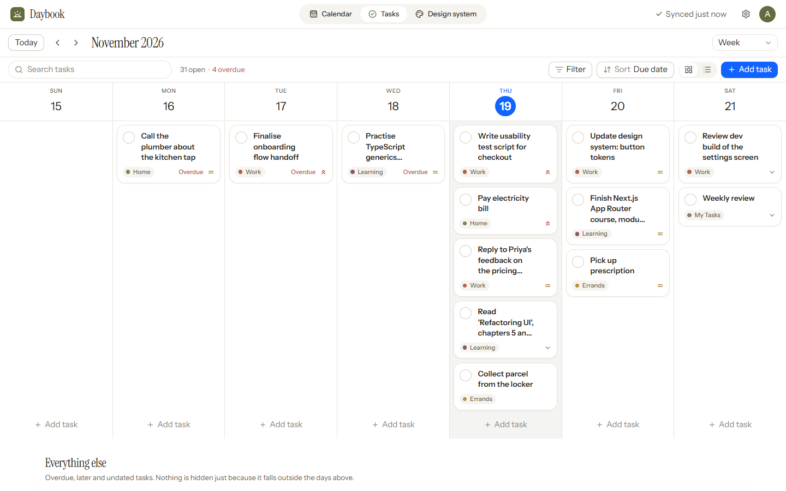

---

## 2026-11-19 — Add task form clean-up

**Asked for:** no "Add details" prompt; labels on every field; due date always Today by default; clear list name; a way back to the Calendar; no "Enter to add" text.

**What changed**
- "Add details" is replaced by a visible **Description** field (optional).
- Every field has a label: Description, Due date, List, Priority.
- Due date defaults to **Today**, unless the task is opened from a specific day, in which case that day is used.
- The list field is labelled **List**, so "My Tasks" is clearly a list choice.
- "Show in Calendar" opens the Calendar on the task's due date (or today if none).
- "Enter to add" is removed.

**Files:** `components/tasks/TaskLayers.tsx`

**Screenshots** (`screenshots/2026-11-19-add-task-form/`)

---

## 2026-11-19 — Remove colour dot from event popover

**Asked for:** remove the green square beside the event title when an event is opened.

**What changed**
- The popover no longer shows the calendar colour square beside the title. The calendar colour still appears on the event blocks.

**Files:** `components/calendar/EventLayers.tsx`

**Screenshots** (`screenshots/2026-11-19-popover-no-dot/`)
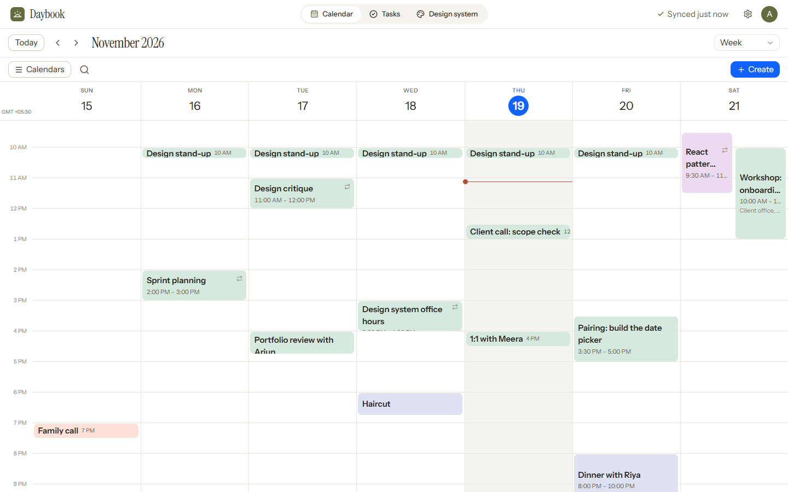

---

## 2026-11-19 — Calendar colours, shadcn view dropdown

**Asked for:** set the four calendar colours (Anjali #3F51B5, Design Studio #0B8043, Learning #8E24AA, Family #F4511E); update the design system tab; use a shadcn component for the Week/Month dropdown.

**What changed**
- Calendars can now take a hex colour directly. The four calendars use the colours above (the request said "Learnig"; the calendar is named "Learning").
- Sample data version bumped so existing browsers pick up the new colours.
- Design system Colour section shows the four calendar colours with their hex values.
- The Week/Month/Day switch in the shared header uses a shadcn-style Select built on Radix (`components/ui/select.tsx`). Type-check and lint pass; not yet tried in the browser.

**Files:** `lib/colors.ts`, `lib/data/mock/seed.ts`, `lib/data/mock/mockRepository.ts`, `components/design/DesignSystem.tsx`, `components/shell/DateHeader.tsx`, `components/ui/select.tsx`, `package.json`

**Screenshots** (`screenshots/2026-11-19-calendar-colours/`)
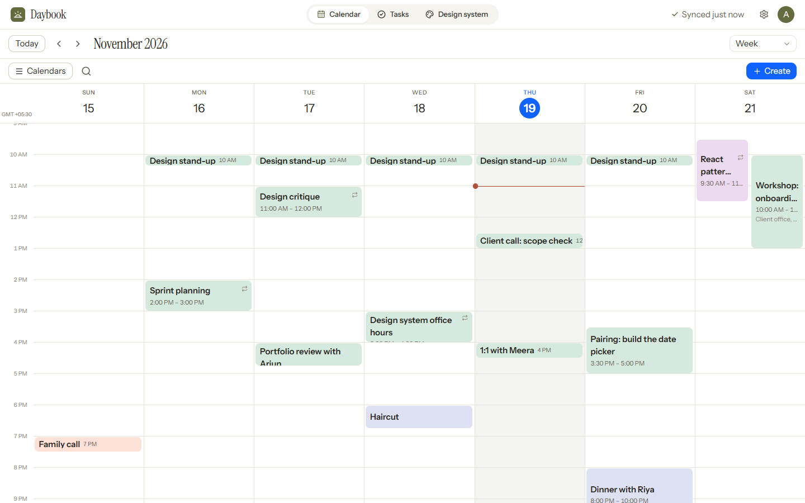

---

## 2026-11-19 — Event colour rule, no edge strip, sidebar, header, ghost button

**Asked for:** the event colour always comes from its calendar; remove the coloured left strip on event blocks; remove the Birthdays and Holidays calendars and the "Other calendars" group, with an "All" toggle; centre the header tabs; ghost button text black by default.

**What changed**
- Events have no colour of their own. Each event takes its calendar's colour everywhere: blocks, month chips, schedule dots, search results. The per-event colour picker is removed from the editor.
- The coloured left strip is removed from event blocks. Blocks are now a soft tint of their calendar colour.
- Birthdays and Holidays calendars and their sample events are removed. The "Other calendars" group is gone. "My calendars" has an **All** toggle that shows or hides every calendar.
- Calendar, Tasks and Design system tabs are centred in the header.
- Ghost button text is black by default (hover unchanged).

**Files:** `components/calendar/TimeGrid.tsx`, `EventLayers.tsx`, `Toolbar.tsx`, `useCalendar.ts`, `Sidebar.tsx`, `components/shell/Header.tsx`, `components/ui/Button.tsx`, `lib/data/mock/seed.ts`, `lib/data/mock/mockRepository.ts`, `lib/store/eventActions.ts`, `lib/store/ui.ts`, `lib/types.ts`, `DESIGN.md`

**Screenshots** (`screenshots/2026-11-19-no-colour-strip/`)
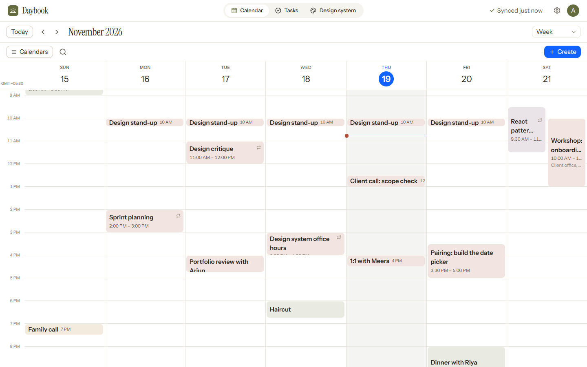

---

## 2026-11-19 — Semantic tokens, month-panel highlight, Tokens tab

**Asked for:** month-panel today and selected colour to the blue; connect them to a token so one change updates everything; rename the token to something semantic; add a Tokens list to the design system with every token.

**What changed**
- Renamed the primary tokens to semantic names: `--semantic-primary`, `--semantic-primary-hover`, `--semantic-on-primary`, `--semantic-destructive`. Components use the matching `bg-semantic-*` classes.
- Month-panel today and selected day now use `--semantic-date-highlight` (text `--semantic-date-highlight-text`), which points at `--semantic-primary`. Change the primary and these follow; retune the date highlight separately if you ever want to.
- Design system has a new **Tokens** section (second in the list) with every token grouped, showing its live value and a swatch for colours.

**Files:** `app/globals.css`, `components/ui/Button.tsx`, `components/ui/DatePicker.tsx`, `components/calendar/CalendarScreen.tsx`, `components/tasks/TasksScreen.tsx`, `components/design/DesignSystem.tsx`, `DESIGN.md`

**Screenshots** (`screenshots/`)
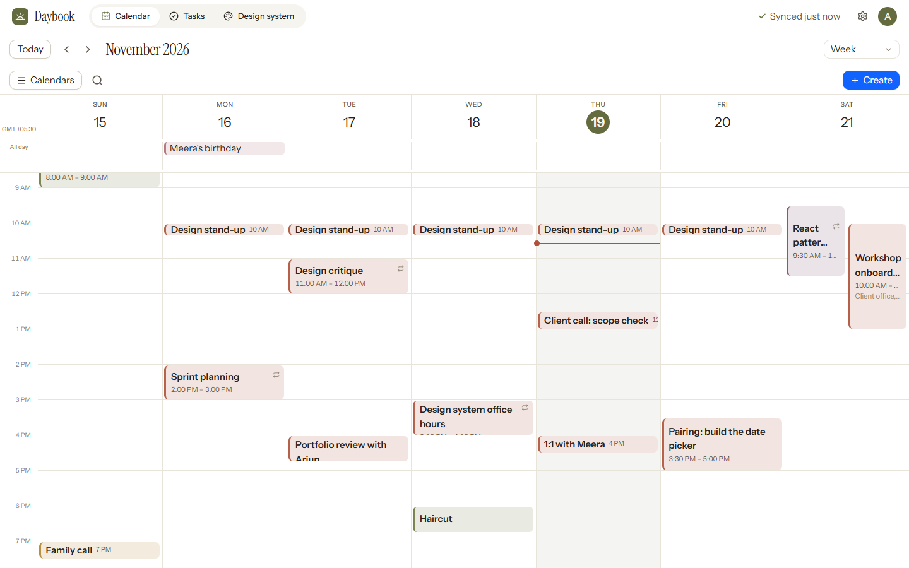
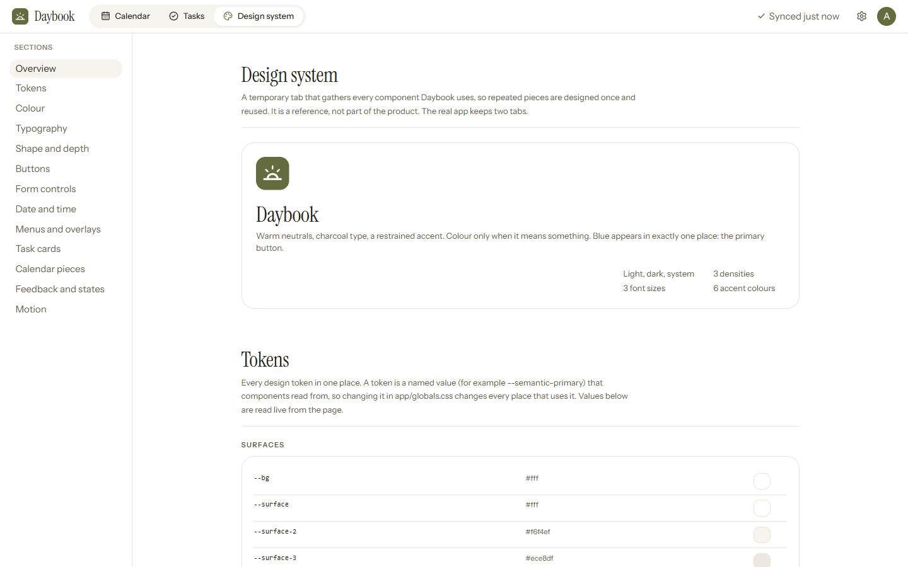

---

## 2026-11-19 — Primary and destructive buttons

**Asked for:** primary button colour `#1163ff` with white text; destructive button keeps white text.

**What changed**
- Primary button fill is `#1163ff` (token `--primary`), with white text (`--on-primary`). This is the only blue in the product.
- Destructive button uses a terracotta fill (`--danger-solid`) with white text.
- Found why the text stayed dark: a global rule set `color: inherit` on every `button`, which overrode the variant colour classes. The rule now covers form fields only.
- The floating Create and Add buttons on phones use the primary colour too.

**Files:** `app/globals.css`, `components/ui/Button.tsx`, `components/calendar/CalendarScreen.tsx`, `components/tasks/TasksScreen.tsx`, `components/design/DesignSystem.tsx`, `DESIGN.md`

**Screenshots** (`screenshots/2026-11-19-primary-button-blue/`)
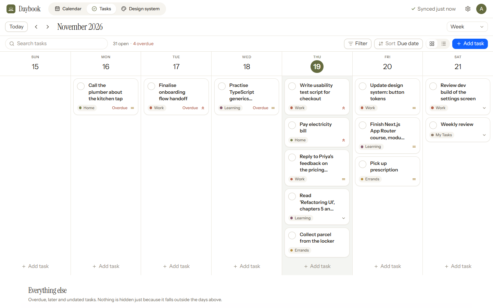
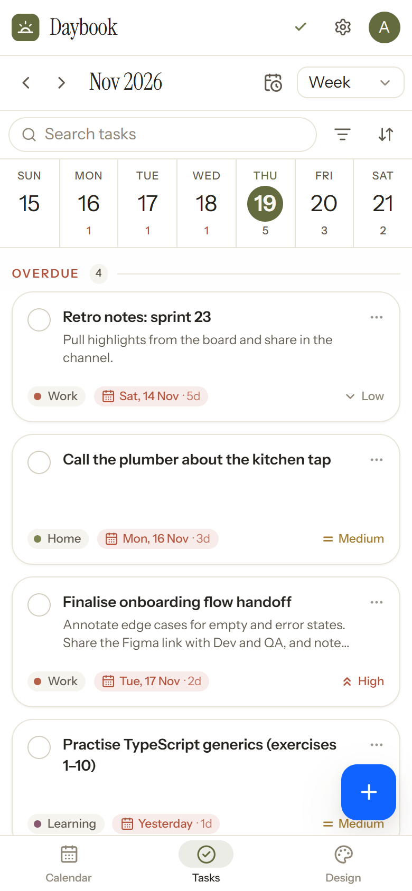

---

## 2026-11-19 — Baseline: the app as it stands today

Starting point for this log. Everything below was built and adjusted earlier in the same project and is shown here as it looks now.

**What exists**
- **Calendar tab:** Day, Week, Month and Schedule views. Click or drag to create events, drag to move, repeating events (this event / all events), event popover and editor, search. Calendars (list, mini month, Create) open in a left **side sheet**.
- **Tasks tab:** Day, Week and Month. On a laptop, Week is **7 day columns** with the same day/date row as the Calendar; tasks outside the days shown sit under "Everything else". On phones it is a single list under the same date row. Quick add, details drawer with autosave, complete/reopen/delete with Undo, search, filter, sort, collapsible Completed.
- **Shared header** on both tabs: Today, previous/next, the date shown, Day / Week / Month switch.
- **Settings:** General, Calendar, Tasks, Notifications, Appearance, Account & sync, Shortcuts.
- **Look:** white page, warm neutral greys, olive accent, charcoal type, no blue. Light, dark and system themes.
- **Design system tab (temporary):** every component, token and state on one page.
- **Data:** sample data only, behind a `Repository` interface so Google Tasks and Calendar can be connected later without UI changes.

**Screenshots** (`screenshots/2026-11-19-baseline/`)

| | |
|---|---|
| Calendar, week | 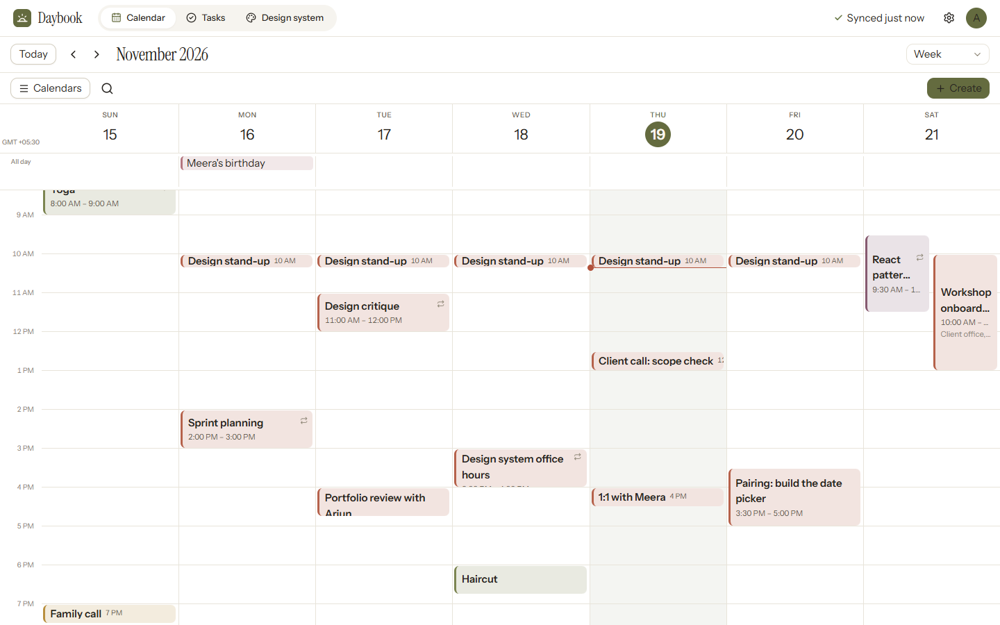 |
| Calendar, month | 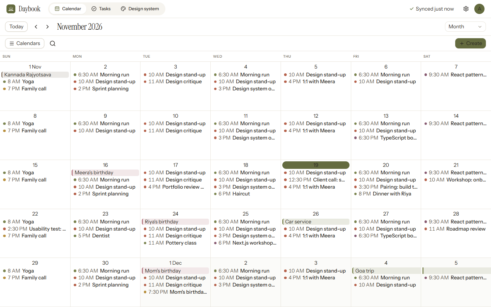 |
| Calendar, schedule | 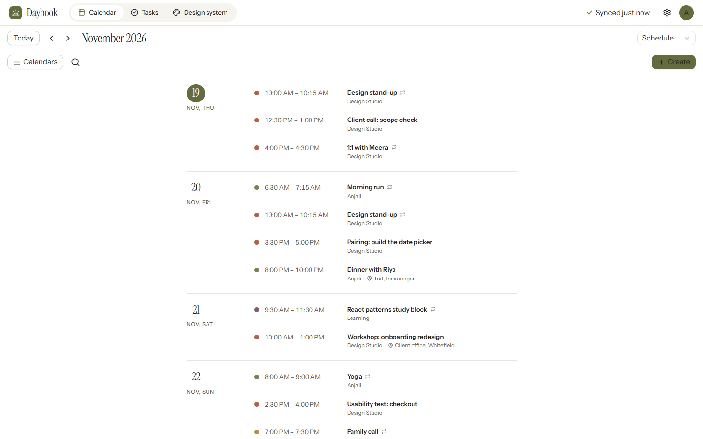 |
| Tasks, week (7 columns) | 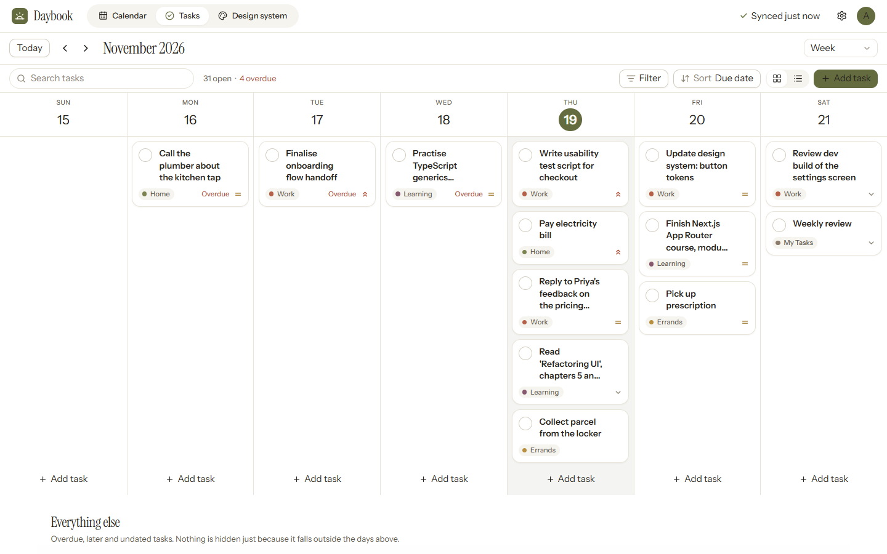 |
| Tasks, day | 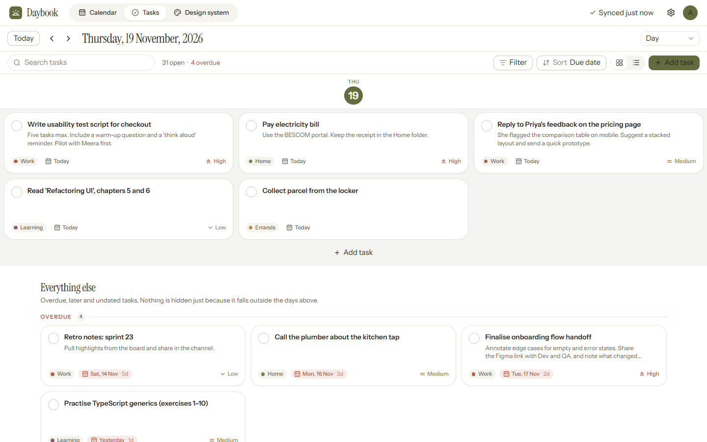 |
| Tasks, month | 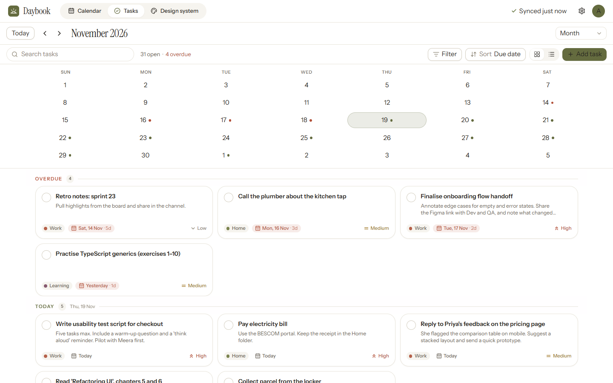 |
| Design system | 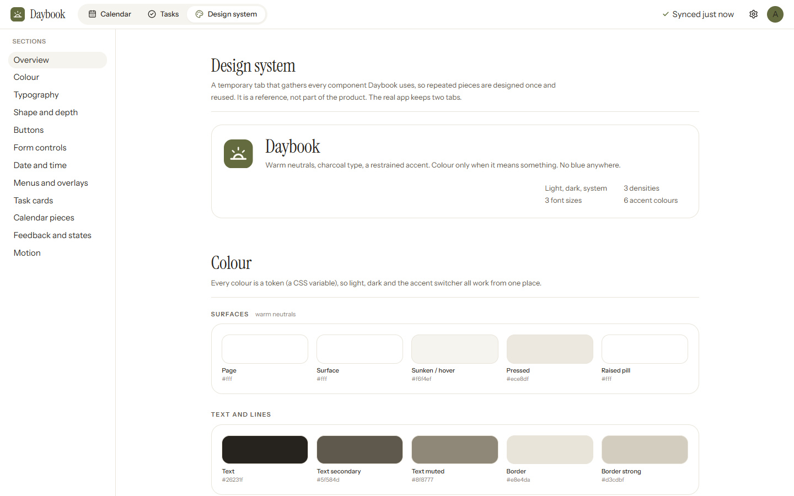 |
| Calendar, phone | 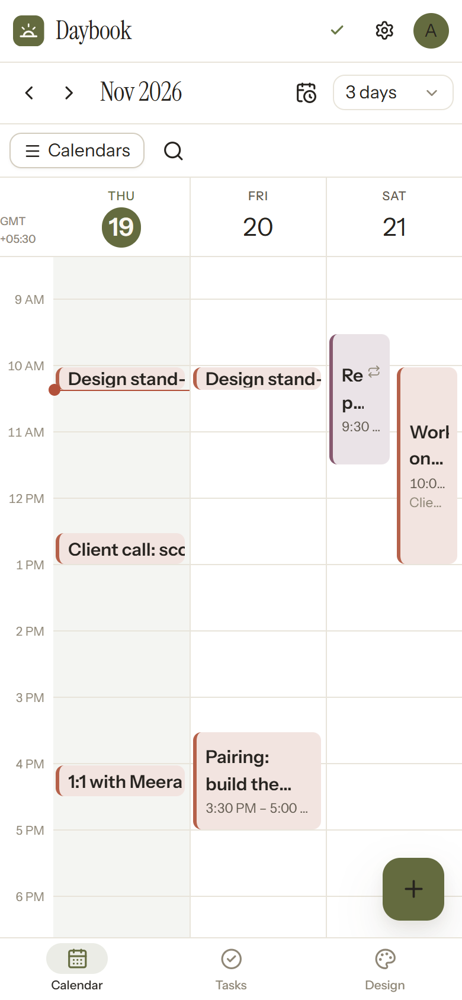 |
| Tasks, phone | 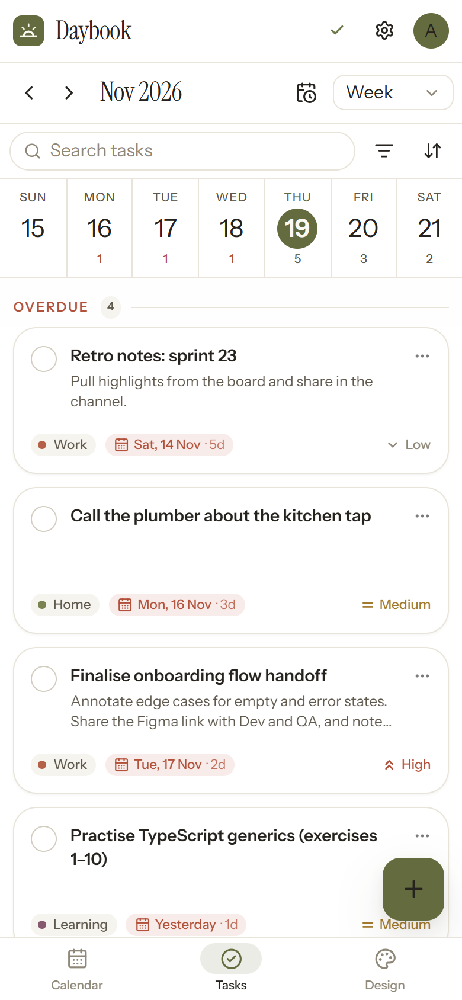 |

**Changes already made earlier on 2026-11-18/19 (not individually screenshotted)**
1. Calendar sidebar became a side sheet that slides over the page.
2. Calendar and Tasks got one shared header with Day / Week / Month.
3. Tasks week became 7 columns; the Tasks day/date row now matches the Calendar's exactly (shared `DayHeaders` component).
4. Light theme changed from warm off-white to white.
5. A temporary Design system tab was added.

---

<!--
ENTRY TEMPLATE (copy above the previous entry)

## YYYY-MM-DD — Short title

**Asked for:** your request in one line.

**What changed**
- ...

**Files:** `path/one.tsx`, `path/two.ts`

**Screenshots** (`screenshots/YYYY-MM-DD-slug/`)

---
-->
